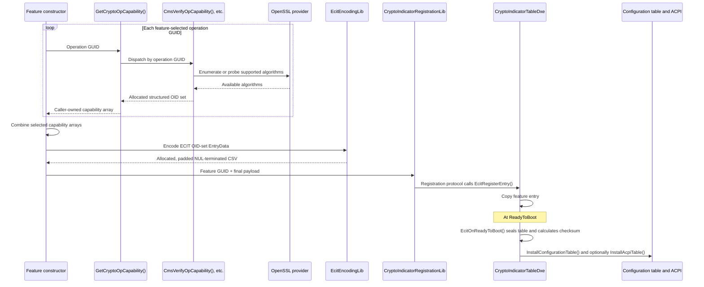
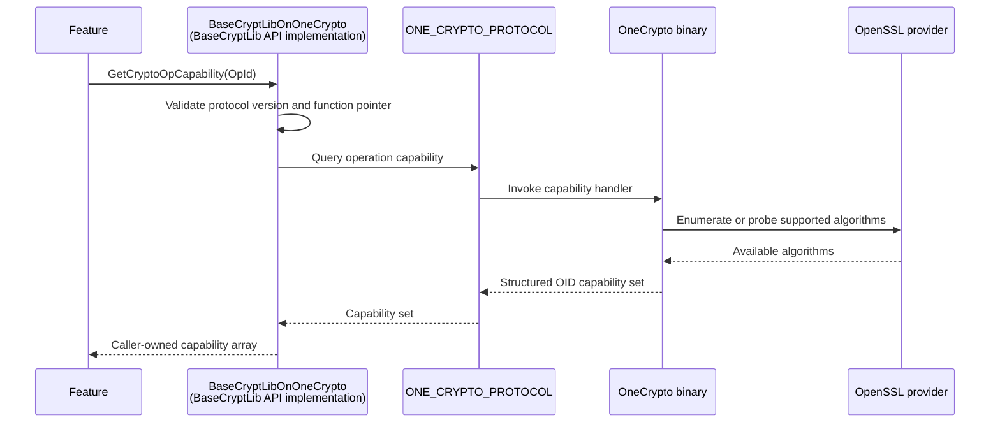
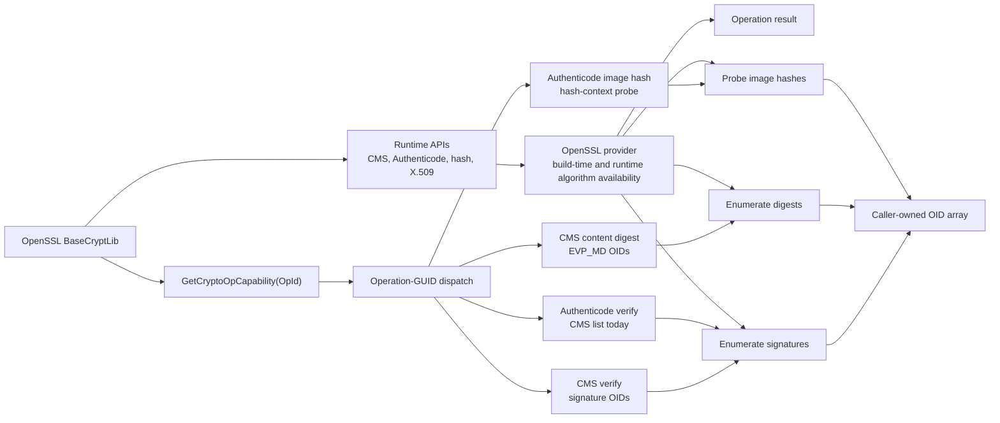

# ECIT Reporting and OneCrypto Execution Flows

This document separates two related but independent paths:

1. The [ECIT reporting path](#ecit-reporting-path), defined by the UEFI
  Specification, discovers, filters, transports, and publishes cryptographic
  capability data.
2. The [CryptoPath](#cryptopath) is implementation-specific and carries a
  cryptographic operation from a feature into the selected crypto provider.
  Capability reporting should dynamically reflect that provider's actual
  capabilities.

Sections marked as proposed describe future feature-policy filtering. All
other sections describe the current implementation.

## ECIT reporting path

This section explains how the firmware asks a crypto provider, such as OpenSSL,
what algorithms it supports and records the answer in ECIT. Four terms are
useful:

- A **provider** is the cryptographic implementation. Here, the provider is
  OpenSSL.
- An **operation** is a specific cryptographic job, such as CMS signature
  verification or PE/COFF image validation or hashing. Operation GUIDs tell
  `GetCryptoOpCapability()` which jobs are being queried.
- A **feature** is the firmware behavior that uses cryptography, such as
  authenticated-variable updates or Secure Boot image verification. A feature
  GUID identifies the ECIT entry that will receive the result.
- A **payload** is the capability data stored in that entry. The current
  crypto-operation payload is a NUL-terminated CSV of algorithm OIDs.



After querying its selected operations, a feature combines the returned arrays,
uses `EcitEncodingLib` to encode its final payload, and passes the result to
`EcitRegisterCryptoCapability()`. The registration library transports the
payload through the phase-appropriate path: the DXE registration protocol, a
Standalone MM queue drained by `CryptoIndicatorBridgeDxe`, or a PEI GUIDed HOB
imported by the collector. At `ReadyToBoot`, the collector seals, checksums,
and publishes the table through the EFI configuration table and, when
available, ACPI.

## Operation mappings and current limitations

- BaseCryptLib exposes four typed operation queries:

  | Operation | OIDs returned | Selected by |
  | --- | --- | --- |
  | `gCryptoOpCmsVerifyGuid` | CMS signature algorithms | `AuthVariableLib` |
  | `gCryptoOpCmsContentDigestGuid` | CMS `SignedData.digestAlgorithms` | `AuthVariableLib` |
  | `gCryptoOpAuthenticodeVerifyGuid` | Authenticode signature algorithms | `DxeImageVerificationLib` |
  | `gCryptoOpAuthenticodeHashGuid` | PE/COFF image-digest algorithms | `DxeImageVerificationLib` |

- `AuthVariableLib` selects both CMS operations. ECIT v1 requires one unordered
  CSV OID set, so the signature and content-digest sets are unioned and
  deduplicated for database-update verification.
- `DxeImageVerificationLib` selects both the Authenticode signature-verification
  operation and the PE/COFF image-hash operation. ECIT v1 requires one
  unordered CSV OID set, so the two sets are unioned and deduplicated. This
  encoding loses the different algorithm roles.
- `AuthenticodeVerifyOpCapability()` currently delegates directly to
  `CmsVerifyOpCapability()`. The separate operation GUID preserves the boundary
  at which Authenticode-specific profile restrictions can be applied later.
- A feature can also supply its own payload, such as the
  `EFI_SIGNATURE_LIST` type GUIDs it accepts from Secure Boot databases.

## CryptoPath

The UEFI Specification does not prescribe how cryptographic operations reach
the crypto provider and does not require a specific implementation. A platform
can select a provider-backed `BaseCryptLib` implementation directly or route
`BaseCryptLib` calls through an abstraction such as OneCrypto.

Capability reporting should, where practical, _dynamically enumerate_ or probe
the implementation selected to perform the operation. This is the preferred
approach because it keeps the reported capabilities aligned with the
implementation as it changes.

A _static capability list_ may be appropriate when dynamic discovery is
unavailable or unsuitable, but it must be maintained alongside the
implementation and validated to prevent the report from becoming stale or
inaccurate.

CMS verification capability reporting dynamically enumerates the signature
and digest algorithms available from the selected provider. Authenticode image
hashing uses a fixed list of candidate algorithms, then probes which ones the
selected implementation can initialize. This hybrid approach preserves the
operation's defined algorithm set while keeping the report aligned with the
provider's actual capabilities.

### OneCrypto configuration described here

In EDK II, the platform DSC selects the library instances used by each
firmware phase. The configuration shown here selects the phase-appropriate
`BaseCryptLibOnOneCrypto` instance. Features continue to call the stable
`BaseCryptLib` API; the selected library routes capability queries through
OneCrypto.



Before capability queries, the loader loads the OneCrypto binary, calls its
entry point, and allocates a `ONE_CRYPTO_PROTOCOL`. `CryptoInit()` fills the
protocol with the binary's linked function addresses, and the loader publishes
it for the current phase. The `BaseCryptLibOnOneCrypto` constructor locates the
protocol, and each wrapper validates its version and function pointer before
entering the binary.

Identically named functions on each side of the protocol are not recursive.
The caller-side symbol is a `BaseCryptLibOnOneCrypto` wrapper; the function
pointer targets the implementation linked into the separate OneCrypto binary.

The returned capability set describes what the linked provider can perform for
an operation; it does not select the algorithm used by an individual CMS,
Authenticode, or image-hash verification. Selection occurs when the feature
invokes the corresponding runtime operation through `BaseCryptLib`.

## OpenSSL BaseCryptLib implementation

This diagram expands the OpenSSL end of the CryptoPath.



For signature reporting, BaseCryptLib combines OpenSSL's legacy
digest-plus-key signature mappings with algorithms exposed directly through
`EVP_SIGNATURE`. `AuthenticodeVerifyOpCapability()` currently returns the same
signature list as `CmsVerifyOpCapability()`, while
`AuthenticodeHashOpCapability()` separately probes the digest implementations
used to hash PE/COFF images.

`CmsContentDigestOpCapability()` enumerates fixed-output `EVP_MD`
implementations for CMS `SignedData.digestAlgorithms`. `AuthVariableLib`
combines that list with the CMS signature capabilities used for authenticated
database-update verification.

The capability branch ends at the caller-owned structured OID array.
`EcitEncodingLib` is intentionally outside this OpenSSL diagram: the feature
owner combines the operation-specific arrays and passes its final OID set to
`EcitEncodingLib` to produce ECIT EntryData.

## Proposed capability and policy separation

ECIT distinguishes three different sets:

1. **Provider capability** is the operation-specific set returned by
   `GetCryptoOpCapability()`. It reflects the linked crypto implementation and
   its configured providers.
2. **Feature policy** is the set the feature owner chooses to allow for its
   particular use. It can be stricter than provider capability because of
   Secure Boot policy, compatibility requirements, deployment policy, or a
   product profile.
3. **Reported capability** is the intersection of provider capability and
   feature policy. This is the only set published for an ECIT feature.

The capability query/filter interface will let a feature owner retrieve the
current provider-supported records, apply an allow-list or policy predicate,
and serialize the resulting allowed records as the ECIT payload. The query
result is runtime data, not a static copy of the provider's algorithm table.

The filter operates on the operation payload's defined records, not by
rewriting arbitrary bytes. The current v1 OID-list payload can therefore be
filtered by OID. A future Authenticode payload must expose structured
`(CMS digest OID, signature OID)` profiles, and its policy filter must retain
or remove complete profiles. Filtering signature OIDs alone would incorrectly
describe pure algorithms such as ML-DSA.

This keeps policy with the feature owner while preserving an honest view of
what the linked provider can do. It also makes the report stable when one
feature intentionally disallows an algorithm that another feature still uses.

## Current library responsibilities

| Layer | Responsibility |
| --- | --- |
| BaseCryptLib / OneCrypto | Return an allocated, operation-specific array of structured OID capabilities. |
| Feature owner | Select the relevant operations, combine their capability arrays, and choose the final feature payload. |
| `EcitEncodingLib` | Validate and deduplicate a structured OID set, then encode an allocated, padded NUL-terminated CSV payload. |
| `CryptoIndicatorRegistrationLib` | Submit the final `(FeatureIdentifier, Payload)` pair through a boot-time DXE/UEFI driver, Standalone MM, or PEI HOB transport. DXE-runtime reporting is not supported. |
| Collector | Import/copy records, reject duplicate feature IDs, seal the table, and publish it. |

The proposed feature-policy filtering described above would operate between
the BaseCryptLib query and `EcitEncodingLib`; it is not a second reporting or
transport layer.

`EcitReportLib` is not part of the current design. Its redundant reporting
wrapper and library instances were removed; feature owners call
`EcitEncodingLib` and `CryptoIndicatorRegistrationLib` directly.

## Phase-specific transports

### PEI

PEI features such as Intel Boot Guard finish before the DXE registration
protocol exists. They use the same `EcitRegisterCryptoCapability()` API through
the PEI `CryptoIndicatorRegistrationLib` instance. Each call validates its
arguments and creates one zero-padded `gEdkiiEcitCapabilityHobGuid` HOB, so
features report independently without shared mutable state.

The HOB contains transport metadata and EntryData, not a serialized
`EFI_CRYPTO_INDICATOR_ENTRY`:

```c
#define EDKII_ECIT_CAPABILITY_HOB_REVISION  1

typedef struct {
  UINT16      Revision;
  UINT16      HeaderSize;
  UINT32      EntryDataSize;
  EFI_GUID    FeatureIdentifier;
  // UINT8    EntryData[];
} EDKII_ECIT_CAPABILITY_HOB;
```

`HeaderSize` permits compatible extension of the transport header. EntryData
begins at `HeaderSize`, and `EntryDataSize` does not include the header.
The collector, rather than the PEI producer, remains responsible for
`EFI_CRYPTO_INDICATOR_ENTRY.EntryLength`, reserved fields, table layout, and
the final checksum.

`CryptoIndicatorTableDxe` imports all matching HOB instances before installing
`gEfiCryptoIndicatorRegistrationProtocolGuid`. It accepts only HOBs with:

- Enough data for the fixed header, a supported `Revision`, and a bounded
  `HeaderSize`.
- An `EntryDataSize` that exactly matches the aligned HOB size and produces an
  ECIT entry that fits `UINT16 EntryLength`.
- A valid, nonzero feature identifier.

Accepted records pass through `EcitRegisterEntry()` and therefore use the same
copy, count, size, and duplicate checks as DXE and Standalone MM records.

Malformed, unsupported, duplicate, or uncopyable PEI records are reporting
integrity failures. The collector must log the specific HOB and status and
must not silently publish a table that appears complete while omitting that
record. A PEI producer only learns whether HOB creation succeeded; import
failures are therefore diagnosed by the DXE collector.

Feature identifiers remain globally unique across every phase. Importing PEI
records before protocol installation gives early-boot features deterministic
ownership. A later DXE or Standalone MM attempt to report the same feature is
rejected with `EFI_ALREADY_STARTED`; platforms should select exactly one owner
for each feature.

### Standalone MM

Standalone MM code cannot locate the DXE registration protocol directly. A
feature therefore reports through `CryptoIndicatorRegistrationLibStandaloneMm`.
Although `AuthVariableLib` can run in both `DXE_RUNTIME_DRIVER` and
`MM_STANDALONE`, only the Standalone MM instance supports ECIT reporting. The
DXE-runtime module uses the null registration library and cannot depend on the
boot-services collector or publish runtime updates.

When a platform links `AuthVariableLib` into Standalone MM with the functional
`CryptoIndicatorRegistrationLib` instance, it reports the Secure Boot
database-update features:

- `gEfiEcitFeatureSbDatabaseUpdateVerificationGuid` describes the
  crypto-operation algorithms used to verify authenticated database updates.
- `gEfiEcitFeatureSbDatabaseUpdateAuthorizationGuid` describes the
  `EFI_SIGNATURE_LIST` type GUIDs accepted to authorize those updates.

The MM registration library copies each feature record into MM-owned memory.
On the first successful registration it installs an MMI handler identified by
`gEcitMmBridgeHandlerGuid`. It does not publish an ECIT table and does not
write DXE memory.

At `ReadyToBoot`, `CryptoIndicatorBridgeDxe` runs at `TPL_NOTIFY`, before the
collector's `TPL_CALLBACK` sealing event. The bridge requests queued records
through `EFI_MM_COMMUNICATION2_PROTOCOL`, starting with a 4 KiB buffer and
retrying once with the exact required size when allowed by the format. It
validates the returned header and packed records before registering them
through the regular DXE path.

The Standalone MM registration instance contains module-local static state and
installs one MMI handler. A platform must link it into only one MM module.
If multiple MM feature owners need ECIT reporting, they must report through
that module or use a platform-provided MM aggregation design.

Each feature identifier may be registered only once with the DXE collector.
Because the DXE-runtime instance uses the null registration library, the
Standalone MM module is the only functional owner of authenticated-variable
ECIT reporting.

## Host-based tests

- `CryptoIndicatorRegistrationLibPeiGoogleTest` covers argument validation,
  the GUID HOB payload-size boundary, allocation failure, metadata, payload
  copying, 8-byte alignment, and zero padding.
- `CryptoIndicatorTableDxeGoogleTest` covers PEI HOB import, protocol
  installation, duplicate and late registration, caller-buffer ownership,
  aligned serialization, checksum generation, configuration-table
  publication, and ReadyToBoot sealing.
